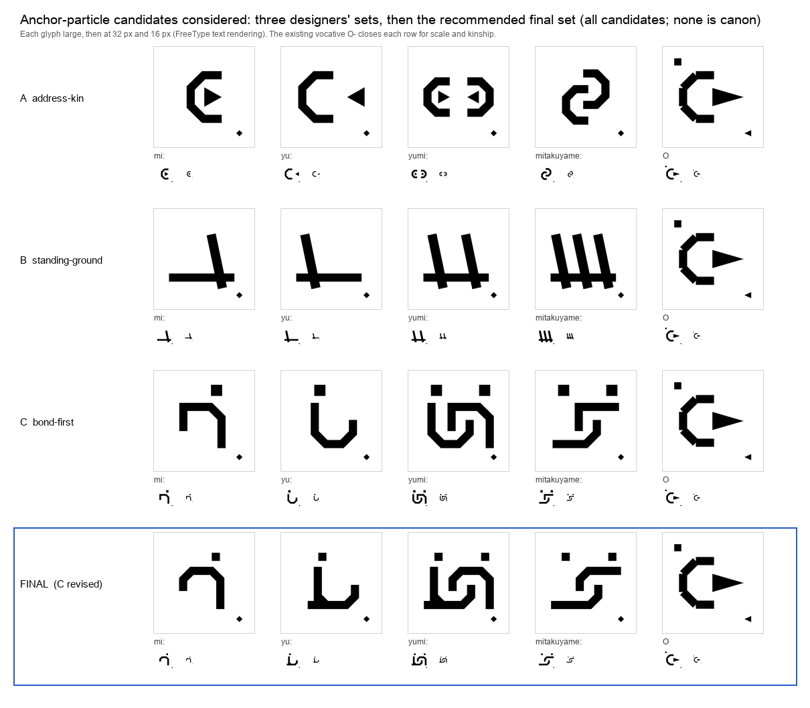

# Anchor-particle glyph candidates, 2026-11 (candidates, not canon)

Four morphemes of the script are catalogued but not drawn: the anchor particles of
`grammars/ankyrance/`, `mi:` (U+E17C), `yu:` (U+E17D), `yumi:` (U+E17E) and `mitakuyame:`
(U+E17F). This folder is the record of one design round for them, made by Claude agents on
2026-11-10 after Yu asked for glyph design to be furthered.

**Nothing here is canon.** No entry was added to `script/glyphs/glyph_specs_v1.py`, and
`morphemes.json`, `codepoints.md`, the fonts and every generated file are untouched. A
canonized glyph never changes (`script/philosophy.md`), so the choice belongs to the
language's owner. The open choices are listed in [`final/decisions.md`](final/decisions.md).

**Update, 2026-11-10.** After this record was written, Yu answered the open choices
("Lets go for what you recommended sensible actions for the above decision"), and `mi:`,
`yu:` and `yumi:` from `final/specs.py` were entered into `script/glyphs/glyph_specs_v1.py`
unchanged apart from the domain tag (`relation+between`, an existing tag, in place of the
unregistered `relation+position`). `mitakuyame:` was not entered: the entering session
held it until Lakota speakers have been consulted, which is that session's reading and not
Yu's own words. Everything below describes the round as it stood before that, at commit
`621977a`. The two scripts reproduce the committed images and numbers at that commit; on a
tree where the three glyphs are in the font, the audit's own assertions (93 drawn glyphs,
the anchors absent) no longer hold.



## How the round ran

1. Three designers worked independently from three different ideas:
   `A-address-kin/` (the vocative's mouth-arc and breath, held), `B-standing-ground/`
   (stakes on a shared ground line) and `C-bond-first/` (the dyad drawn first, its halves
   derived from it). Each folder holds the set's `specs.py`, `glyphs.svg.json` and the
   designer's `rationale.md`.
2. Two judges looked for faults: one against the script's written rules and the chapter's
   three laws, one by measurement (`audit/confusability.py`, which rasterises all 93 drawn
   glyphs and every candidate and compares them under rotation and mirroring, calibrated
   against how close the script's own glyphs already are to each other).
3. A final step took set C as its base, applied or declined each fix with reasons, and
   re-ran the audit. The result is in `final/`: `specs.py`, `sheet.png`,
   `design_notes.md` and `decisions.md`.

## What to know before choosing

- **The meaning question comes first.** The designs follow the chapter's ladder as written
  (self, other, dyad, all relations). The donor digs added in the same round found that Tok
  Pisin *yumi* is the inclusive "we" of any number (the dyad is *yumitupela*) and that
  Lakota *mitákuye* means "my relative"
  (`archaeology/tok-pisin/pronouns-clusivity-and-number.md`,
  `archaeology/lakota/mitakuye-oyasin-form-and-sound.md`). If the chapter's meanings change,
  the glyphs should be looked at again.
- **`mitakuyame:` is the weak rung.** To stay distinguishable from `yumi:` it opens both
  figures' bodies, which the doctrine judge read as breaking the Law of Visible Constituents.
  The alternatives that were measured are in `final/audit/top_rung_alternatives.png` and
  `final/decisions.md` §2.
- **No person has tested these.** Every distinctness claim rests on a bitmap measure, not a
  reading test, and no Lakota speaker has seen the `mitakuyame:` candidate.

## Regenerating

From this folder, with Homebrew Python (fontTools, Pillow, numpy):

```
/opt/homebrew/bin/python3 -B final/work/run_audit.py   # audit of all four sets -> final/audit/
/opt/homebrew/bin/python3 -B final/render.py           # sheet.png, compare.png, glyphs.svg.json
```

Both read the repository's own glyph modules and write only inside this folder. Checked on
2026-11-10: they reproduce the committed images and numbers byte for byte. The designers'
rationales mention prototype folders (`proto/`, `work/`) that were working files and were
not kept.
